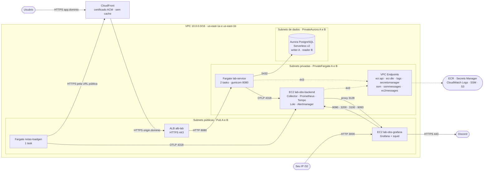

# Notas da Nuvem na AWS — Terraform, observabilidade e CI/CD

Tradução em módulos Terraform da arquitetura documentada na Entrega 1
(aplicação **Notas da Nuvem** em `https://app.labdenuvemarquiteturavinicius.click`).
O código já nasce na **topologia final**: CloudFront + ALB + ECS Fargate + Aurora, HTTPS com ACM
do navegador até o ALB e **sem NAT Gateway**, com a saída das tasks só por VPC Endpoints. Por cima
dela fica a stack de **observabilidade** (OpenTelemetry, Prometheus, Tempo, Loki, Alertmanager →
Discord e Grafana) em duas EC2, e tudo é entregue por um **pipeline de CI/CD** (CodePipeline +
CodeBuild) com portões de segurança e de observabilidade.

## Destaques

- **100% Terraform:** 13 módulos em duas stacks (ambiente e pipeline), estado remoto no S3 com lock
  nativo e cifrado com KMS.
- **Zero NAT Gateway:** 7 VPC Endpoints de interface + 1 gateway (S3). Aplicação, banco e backend de
  observabilidade não têm IP público; o acesso administrativo é só pelo Session Manager (sem SSH,
  sem bastion, sem chave).
- **Três sinais do OpenTelemetry correlacionados:** trace → logs → trace no Grafana, com SLO de
  disponibilidade (99,5%) e latência (p95 ≤ 500 ms) e alertas no Discord.
- **14 portões automáticos no pipeline:** segredos no histórico, dependências vulneráveis, SAST,
  IaC, fitness function de observabilidade, CVEs da imagem, plano destrutivo e smoke test pós-deploy.
- **Menor privilégio:** nenhuma access key, uma role por tipo de trabalho, permission boundary nas
  roles que o pipeline cria.
- **Falha controlada:** uma variável (`simulate_db_failure`) derruba o banco, e dá para acompanhar o
  SLI caindo, o trace com a exceção e o alerta chegando no Discord.

| Documento | Para quê |
|---|---|
| [GUIA.md](GUIA.md) | Passo a passo do lab: subir, tirar os 13 prints na ordem, simular a falha, destruir |
| [CICD.md](CICD.md) | Pipeline de CI/CD (Aula 14): CodePipeline + CodeBuild com gitleaks, pip-audit, Bandit, Trivy, tflint e a fitness function de observabilidade; bootstrap, evidências e exceções |
| [Evidencias_Observabilidade_SRE.pdf](Evidencias_Observabilidade_SRE.pdf) | Evidências do lab de observabilidade (Aula 13) |
| [Evidencias_notas-pipeline.pdf](Evidencias_notas-pipeline.pdf) | Evidências do pipeline de CI/CD (Aula 14) |

## Arquitetura

### Visão geral



Serviços de borda e de conta, fora da VPC: **Route 53** (hosted zone pública já existente, registros
`app.` e `origin.`), **ACM** (um certificado para o domínio e `*.dominio`, usado pelo CloudFront e
pelo ALB), **ECR**, **Secrets Manager**, **CloudWatch Logs** e **AWS Budgets**.

### Caminho de uma requisição

1. `app.labdenuvemarquiteturavinicius.click` é um alias (registro A) para a distribuição do CloudFront.
2. O **CloudFront** termina o TLS com o certificado do ACM (mínimo `TLSv1.2_2021`, HTTP redireciona
   para HTTPS). Cache desligado (`Managed-CachingDisabled`) e todos os cabeçalhos repassados
   (`Managed-AllViewer`): a aplicação é dinâmica e recebe `POST`.
3. A origem é `origin.<domínio>`, alias para o ALB, alcançado em **HTTPS** (`https-only`, TLS 1.2). O
   nome bate com o certificado curinga, então o TLS valida até o ALB.
4. O **ALB** fica nas subnets públicas, mas o sg `alb` só aceita a porta 443 da prefix list gerenciada
   do CloudFront (`com.amazonaws.global.cloudfront.origin-facing`): ninguém fala direto com ele. Listener
   HTTPS com `ELBSecurityPolicy-TLS13-1-2-2021-06` e `drop_invalid_header_fields`.
5. O target group `tg-lab` (tipo IP) encaminha em HTTP 8080 para as **tasks Fargate**, nas subnets
   privadas, sem IP público. Health check em `/health` com timeout de 10 s.
6. A task fala com o **Aurora** pelo endpoint do writer na 5432. Usuário e senha vêm do segredo que o
   próprio RDS gerencia no Secrets Manager, injetados pelo ECS como `secrets`.
7. Imagem, logs e segredos saem pelos **VPC Endpoints**; as camadas da imagem vêm do S3 pelo endpoint
   gateway. Cada requisição gera trace, métricas e logs, enviados por OTLP ao backend de observabilidade.

### Rede

| Subnet | CIDR | AZ | Rota padrão | O que roda |
|---|---|---|---|---|
| `Pub(A)` | 10.0.1.0/24 | us-east-1a | Internet Gateway | ALB, EC2 do Grafana (`10.0.1.250` + EIP), loadgen |
| `Pub(B)` | 10.0.2.0/24 | us-east-1b | Internet Gateway | ALB, loadgen |
| `PrivateFargate(A)` | 10.0.11.0/24 | us-east-1a | nenhuma | tasks, VPC Endpoints, EC2 de backend (`10.0.11.250`) |
| `PrivateFargate(B)` | 10.0.12.0/24 | us-east-1b | nenhuma | tasks, VPC Endpoints |
| `PrivateAurora(A)` | 10.0.21.0/24 | us-east-1a | nenhuma | Aurora writer |
| `PrivateAurora(B)` | 10.0.22.0/24 | us-east-1b | nenhuma | Aurora reader |

Duas route tables: `routetable-publica` (`0.0.0.0/0` → IGW) e `routetable-privada`, compartilhada
pelas subnets de aplicação e de dados, só com a rota local e a do endpoint gateway do S3. Sem NAT,
uma subnet privada **não tem como** sair para a internet.

### Componentes

| Camada | Recurso | Configuração |
|---|---|---|
| Borda | CloudFront | `PriceClass_All`, IPv6, compressão, sem cache, alias `app.` |
| DNS e TLS | Route 53 + ACM | zona existente (só lida); certificado `dominio` + `*.dominio` com validação DNS. A região é travada em `us-east-1` porque o mesmo certificado serve o CloudFront e o ALB |
| Entrada | ALB `alb-lab` | público, em Pub A/B, só HTTPS 443, registro `origin.` |
| Aplicação | ECS Fargate `lab-cluster` / `lab-service` | 2 tasks (uma por AZ), 0,25 vCPU / 512 MiB, x86_64, task definition `lab-test`, *circuit breaker* com rollback, grace period de 120 s, logs em `/ecs/labarquiteturanuvem` (7 dias) |
| Dados | Aurora PostgreSQL 16.15 Serverless v2 `lab-aurora2` | 0 a 2 ACU com pausa automática após 5 min ocioso, writer em us-east-1a e reader em us-east-1b, armazenamento cifrado, senha gerenciada no Secrets Manager, Data API ligada, backup de 1 dia |
| Imagens | ECR | IMMUTABLE, scan on push, AES256. `labarquiteturanuvem` (app e loadgen) e `lab-obs/*` (5 espelhos do Docker Hub) |
| Saída privada | VPC Endpoints | 7 de interface nas duas PrivateFargate (`ecr.api`, `ecr.dkr`, `secretsmanager`, `logs`, e `ssm`, `ssmmessages`, `ec2messages` quando a observabilidade está ligada) + gateway do S3 |
| Observabilidade | EC2 `lab-obs-backend` | t3.medium, 20 GiB gp3 cifrado, Amazon Linux 2023, 5 containers |
| Observabilidade | EC2 `lab-obs-grafana` | t3.small, 10 GiB gp3 cifrado, EIP, Grafana + squid |
| Carga | ECS `notas-loadgen` | 1 task de 0,25 vCPU / 512 MiB nas subnets públicas |
| Custo | AWS Budgets | US$ 100/mês; e-mail com 85% e 100% do gasto real e 100% do previsto |

### Security groups

Todas as regras referenciam outro SG, e não um CIDR, exceto a do CloudFront (prefix list) e a do
Grafana (seu IP).

| SG | Entrada | Saída |
|---|---|---|
| `alb` | 443 da prefix list do CloudFront | 8080 só para o sg `app` |
| `app` | 8080 só do sg `alb` | liberada (endpoints, Aurora, Collector e, no loadgen, o CloudFront) |
| `db` | 5432 só do sg `app` (removida com `simulate_db_failure = true`) | nenhuma |
| `endpoint` | 443 de `app`, `obs-backend` e `obs-grafana` | nenhuma |
| `obs-grafana` | 3000 só de `grafana_allowed_cidrs` (seu IP /32; `0.0.0.0/0` é recusado pela validação); 3128 só de `obs-backend` | liberada (imagem do Grafana, consultas ao backend, Discord) |
| `obs-backend` | 4318 só de `app`; 9090, 3200, 3100 e 9093 só de `obs-grafana` | liberada (sem NAT: na prática, só a VPC e os endpoints) |

## Segurança

- **Rede:** nada da aplicação, do banco ou do backend de observabilidade tem IP público. O ALB só
  aceita o CloudFront; o Aurora só aceita as tasks. Administração só pelo Session Manager.
- **TLS:** CloudFront com `TLSv1.2_2021`, CloudFront → ALB em `https-only` (TLS 1.2) e listener do ALB
  com a política `TLS13-1-2-2021-06`.
- **Segredos fora do código e do `user_data`:**
  - senha do banco gerada e guardada pelo RDS (`manage_master_user_password`) e injetada pelo ECS
    (não aparece na task definition). A execution role só lê esse segredo;
  - senha do admin do Grafana aleatória (24 caracteres), guardada no Secrets Manager e lida pela EC2
    no boot. Cadastro e acesso anônimo desligados;
  - webhook do Discord marcado como `sensitive`, validado por regex, guardado no Secrets Manager e
    entregue ao Alertmanager num arquivo `chmod 400` (`webhook_url_file`). Não aparece no
    `alertmanager.yml`.
- **Cifragem em repouso:** Aurora, discos das EC2 (gp3), ECR (AES256), estado do Terraform e
  artefatos do pipeline (KMS com rotação).
- **EC2:** IMDSv2 obrigatório, AMI Amazon Linux 2023 resolvida pelo parâmetro público do SSM, roles
  separadas por instância (`lab-obs-ec2` e `lab-obs-grafana`).
- **Imagem:** base fixada por digest, pacotes do SO atualizados, roda como usuário não-root, sem pip
  no runtime, scan on push no ECR e Trivy no pipeline.
- **Telemetria também é dado:** o `db.statement` sai com o placeholder (`VALUES (%s)`), nunca com o
  texto da nota, e um teste do pipeline barra qualquer regressão nisso.
- **Proteções no próprio Terraform:** `allowed_account_ids` (não aplica na conta errada), região
  validada, `grafana_allowed_cidrs` sem `0.0.0.0/0`, `precondition` nas imagens do backend e
  `default_tags` (`Project`, `ManagedBy = terraform`) em todos os recursos.
- **Pipeline:** sem access keys, quatro roles do CodeBuild + uma do CodePipeline, permission boundary,
  plano aprovado = plano aplicado. Detalhes em [CICD.md](CICD.md#segurança-do-próprio-pipeline-sec11-bp07).

## Estrutura

```
.
├── docs/                     # README, GUIA, CICD e os PDFs de evidências
├── versions.tf               # Terraform >= 1.10, provider AWS ~> 6.0, backend S3 (parcial: backend.hcl)
├── providers.tf              # região, trava de conta, default_tags
├── variables.tf              # padrões = valores da documentação, com validações
├── main.tf                   # composição dos módulos e variáveis OTEL_* das tasks
├── outputs.tf
├── terraform.tfvars.example
├── backend.hcl.example       # estado remoto (bucket criado por cicd/)
├── app.py                    # código da Notas da Nuvem (o mesmo da imagem base, com o aceite do B104)
├── Dockerfile                # targets test (fitness function), app (Notas da Nuvem + OTel) e loadgen
├── requirements*.txt         # dependências fixadas (lidas pelo pip-audit)
├── loadgen/loadgen.py        # gerador de tráfego
├── buildspecs/               # CodeBuild: seguranca, iac, observabilidade, imagem, plan, deploy
├── tests/                    # fitness function de observabilidade (OpenTelemetry)
├── ci/ · security/           # ferramentas de CI com hashes · baseline do Bandit
├── .gitleaksignore · .trivyignore.yaml · .tflint.hcl   # exceções e regras dos scanners
├── .github/CODEOWNERS        # revisão obrigatória de buildspecs, testes e exceções
├── cicd/                     # stack do pipeline (estado próprio): CodePipeline, CodeBuild, IAM, KMS, S3
├── scripts/
│   ├── build-push.sh         # builda e envia app-2.2.0 e loadgen-1.1.0
│   └── mirror-images.sh      # copia as imagens do backend de observabilidade para o ECR (linux/amd64)
└── modules/
    ├── budget/               # Passo 1 — AWS Budgets (85% / 100% real, 100% previsto)
    ├── network/              # Passo 2 — VPC, 6 subnets em 2 AZs, IGW, route tables
    ├── security-groups/      # Passo 2.3 — alb → app → db, + endpoint
    ├── vpc-endpoints/        # Passo 8 — ecr.api, ecr.dkr, secretsmanager, logs + S3 gateway (+ ssm* com observabilidade)
    ├── aurora/               # Passo 3 — subnet group, cluster Serverless v2, writer + reader
    ├── ecr/                  # Passo 4 — repositório IMMUTABLE, scan on push (reusado para lab-obs/*)
    ├── acm/                  # Passo 7.1 — certificado domínio + curinga, validação DNS
    ├── alb/                  # Passos 5.3 / 7.3 / 7.4 — ALB, tg-lab (IP), HTTPS:443, registro origin.
    ├── ecs/                  # Passo 5 — log group, execution role, cluster, task definition, service
    ├── cloudfront/           # Passos 6 / 7.5 / 7.6 — distribuição, alias app., registro app.
    ├── observability/        # EC2 Grafana (pública) + EC2 backend (privada: Collector, Prometheus, Tempo, Loki, Alertmanager)
    │   ├── config/           #   configs de cada componente, regras de alerta e dashboard de SLI
    │   └── templates/        #   user_data das duas instâncias
    ├── loadgen/              # service extra notas-loadgen (1 task que gera tráfego e logs)
    └── cicd/                 # pipeline da Aula 14 (usado só por cicd/)
```

O `Dockerfile` é multistage sobre a imagem pública `rafaelserpa/notas-da-nuvem:1.0.0`, fixada
por digest. As imagens de runtime saem sem pip e com os pacotes do SO atualizados ([CICD.md](CICD.md#a-imagem)).

### A aplicação

Flask + psycopg2, servida pelo gunicorn na porta 8080. Três rotas:

| Rota | O que faz |
|---|---|
| `GET /` | lista as notas (`SELECT ... ORDER BY id DESC`) |
| `POST /notas` | grava uma nota (`INSERT INTO notas (texto) VALUES (%s)`) e redireciona para `/` |
| `GET /health` | responde `status: up` e o estado do banco (`database: ok` ou `erro: ...`), sempre com 200 |

Na subida, a aplicação espera o banco (`wait_for_db`, até 10 tentativas) e cria a tabela `notas` se
ela não existir. A configuração vem toda de variáveis de ambiente (`DB_HOST`, `DB_PORT`, `DB_NAME`,
`DB_USER`, `DB_PASSWORD`, `APP_PORT`).

## Dependências entre módulos

| Módulo | Depende de |
|---|---|
| budget | — |
| security-groups | network |
| vpc-endpoints | network, security-groups |
| aurora | network, security-groups |
| alb | network, security-groups, acm |
| ecs | network, security-groups, ecr, aurora, alb, vpc-endpoints |
| cloudfront | acm, alb (registro `origin.`) |
| obs_image_repos | — (repositórios `lab-obs/*` no ECR) |
| observability | network, security-groups, vpc-endpoints, obs_image_repos |
| loadgen | ecs (cluster e execution role), observability (endpoint OTLP) |

O ECS só é criado depois que os endpoints existem, o listener HTTPS está ligado
ao target group e a instância writer do Aurora está disponível.

## Pré-requisitos

- Terraform >= 1.10 e credenciais da conta (`aws configure` / SSO).
- O domínio `labdenuvemarquiteturavinicius.click` com **hosted zone pública** no
  Route 53 (já existe, foi criada no registro do domínio; o código só a lê).
- Docker com buildx, `jq` e o plugin do Session Manager para a AWS CLI.

## Como subir

**Caminho principal: o pipeline.** Depois do bootstrap descrito em [CICD.md](CICD.md#como-subir-bootstrap-uma-vez),
cada push na `main` passa pelos portões de segurança e observabilidade, publica a imagem com a tag do
commit (7 primeiros caracteres do SHA) e aplica a infraestrutura com `terraform apply` revisado. O
roteiro abaixo é o deploy manual, sem pipeline (útil para entender as fases).

O estado fica no bucket S3 criado por `cicd/` (`terraform -chdir=cicd output -raw backend_config > backend.hcl`).
O ECS precisa das imagens no ECR antes de iniciar as tasks, então o primeiro deploy é em duas fases.

```bash
cp terraform.tfvars.example terraform.tfvars
# preencha budget_emails, grafana_allowed_cidrs (curl -s https://checkip.amazonaws.com)
# e discord_webhook_url = "https://discord.com/api/webhooks/<id>/<token>"
terraform init -backend-config=backend.hcl

# Fase 1 — só os repositórios
terraform apply -target=module.ecr -target=module.obs_image_repos

# Imagens
scripts/mirror-images.sh   # Docker Hub -> ECR (collector, prometheus, tempo, loki, alertmanager), linux/amd64
scripts/build-push.sh      # targets app (app-2.2.0) e loadgen (loadgen-1.1.0)

# Fase 2 — todo o resto (Aurora leva de 10 a 15 min)
terraform apply

terraform output grafana_url                    # http://<EIP>:3000
terraform output -raw grafana_admin_password    # login: admin
```

O bootstrap das EC2 leva alguns minutos depois que elas ficam *running*. Log em
`/var/log/obs-bootstrap.log` nas duas.

Para uma versão nova da aplicação: tags novas (o repositório é IMMUTABLE), depois o apply com elas.
Isso gera uma nova revisão da task definition e o service faz o rolling deploy.

```bash
APP_TAG=app-2.3.0 LOADGEN_TAG=loadgen-1.2.0 scripts/build-push.sh
terraform apply -var otel_image_tag=app-2.3.0 -var loadgen_image_tag=loadgen-1.2.0
```

**Sem observabilidade** (`enable_observability = false`): não são criados as EC2, o loadgen, os
endpoints `ssm*` nem os repositórios `lab-obs/*`, e o ECS roda a imagem de `image_tag` (padrão
`v1-1.0.0`), que é a imagem base sem instrumentação reetiquetada no ECR.

### Validação

```bash
terraform output app_url
curl -I "$(terraform output -raw app_url)"
aws ecs describe-services --cluster lab-cluster --services lab-service \
  --query 'services[0].{running:runningCount,desired:desiredCount}'
```

A evidência do `SELECT * FROM notas;` continua pelo RDS Query Editor: a Data
API já vem habilitada, e os ARNs necessários saem em
`terraform output aurora_cluster_arn` e `terraform output aurora_secret_arn`.

## Observabilidade (OpenTelemetry)

Ligada por `enable_observability` (padrão `true`). Diferente da apostila (um único
container `grafana/otel-lgtm`), a stack fica em **duas camadas**:

```
                      seu IP ──3000──▶ EC2 lab-obs-grafana   10.0.1.250  (Pub A, EIP, sg obs-grafana)
                                         │  Grafana + squid (3128) ──443──▶ discord.com
                                         │ 9090 / 3200 / 3100 / 9093          ▲
                                         ▼                                    │ proxy_url
tasks app + loadgen ──OTLP/HTTP 4318──▶ EC2 lab-obs-backend   10.0.11.250 (PrivateFargate A, sem IP público, sg obs-backend)
   (sg app)                               otel-collector ─┬─▶ Tempo       (traces, OTLP gRPC)
                                                          ├─▶ Prometheus  (métricas, remote write) ─▶ Alertmanager
                                                          └─▶ Loki        (logs, OTLP nativo)
```

**Por que duas camadas:** só o Grafana precisa ser alcançado de fora, e mesmo assim só do seu IP.
O que recebe e guarda telemetria fica na subnet privada, sem IP público, e só aceita OTLP do sg `app`.

**Sem NAT:** a EC2 de backend instala o Docker pelo endpoint gateway do S3 (repositórios do
AL2023), puxa as imagens dos repositórios `lab-obs/*` do ECR (espelhadas do Docker Hub por
`scripts/mirror-images.sh`), lê o webhook do Discord pelo endpoint do Secrets Manager e é
acessada pelo Session Manager (endpoints `ssm`, `ssmmessages` e `ec2messages`, criados só com a
observabilidade ligada). O Grafana, na subnet pública, baixa a própria imagem pela internet.

**Saída para o Discord:** VPC Endpoints só cobrem serviços da AWS, então o Alertmanager não
alcança `discord.com` sozinho. A EC2 do Grafana roda um **squid** na 3128 que aceita só o IP do
backend e só `CONNECT` 443 para `*.discord.com`, sem cache; o Alertmanager usa `http_config.proxy_url`.
Para os dois se conhecerem sem dependência circular, os IPs privados são fixos (`.250` de cada
subnet, via `cidrhost`): backend `10.0.11.250`, Grafana `10.0.1.250`.

**Roles separadas (menor privilégio):** `lab-obs-ec2` (backend: SSM, leitura do ECR, segredo do
Discord) e `lab-obs-grafana` (SSM, segredo da senha do admin).

### Fluxo e retenção dos sinais

| Sinal | Caminho | Retenção |
|---|---|---|
| Traces | task → Collector (OTLP/HTTP 4318) → Tempo (OTLP gRPC 4317) | 24 h |
| Métricas | task → Collector → Prometheus (*remote write*, com os atributos de recurso virando rótulos) | 3 dias |
| Logs | task → Collector → Loki (endpoint OTLP nativo `/otlp`) | 72 h |

- O Collector passa os três sinais por `memory_limiter` (400 MiB, pico de 100) e `batch`, roda com
  limite de 512 MiB e só publica a 4318 no host. Os outros containers conversam pela rede Docker
  `obs-net`.
- O Prometheus avalia as regras a cada 15 s e também coleta as métricas do próprio Prometheus, do
  Alertmanager, do Tempo e do Loki.
- Os dados ficam no disco da EC2 (`/opt/obs/data`), com logs dos containers limitados a 3 × 10 MB.
- Versões fixas: Collector contrib 0.120.0, Prometheus 3.2.1, Tempo 2.7.1, Loki 3.4.2,
  Alertmanager 0.28.1 e Grafana 11.5.2.

> Qualquer mudança no `user_data` (configs em `modules/observability/config/` ou nos templates)
> **recria as EC2** (`user_data_replace_on_change`): Prometheus, Tempo e Loki voltam vazios. Os IPs
> privados são fixos, então as tasks não precisam de nova revisão por causa disso.

### O que já vem provisionado

- **Data sources:** Prometheus, Tempo, Loki e Alertmanager (*Receive Grafana Alerts*), todos
  apontando para o IP privado do backend. Alerting > Settings vai para *External*.
- **Correlação entre sinais:** do span no Tempo para os logs do mesmo `trace_id` no Loki (janela de
  ±5 min), do log no Loki de volta para o trace (campo derivado `trace_id`) e *node graph* no Tempo.
- **Regras no Prometheus** ([alert-rules.yml](../modules/observability/config/alert-rules.yml)):

  | Regra | Tipo | Expressão | Por | Severidade |
  |---|---|---|---|---|
  | `sli:disponibilidade:ratio_rate5m` | recording | requisições sem 5xx / total, sem `/health`, janela de 5 min | — | — |
  | `sli:latencia_p95:seconds_rate5m` | recording | p95 do histograma `http_server_request_duration_seconds`, sem `/health` | — | — |
  | `DisponibilidadeAbaixoDoSLO` | alerta | disponibilidade < 99,5% | 1 min | critical |
  | `LatenciaP95Alta` | alerta | p95 > 500 ms | 2 min | warning |
  | `TelemetriaAusente` | alerta | nenhuma métrica da aplicação | 10 min | warning |

  O Prometheus avalia, o Alertmanager agrupa por `alertname` (espera 10 s, reagrupa a cada 1 min,
  repete a cada 30 min) e o `discord_configs` (`send_resolved: true`) avisa no canal.
- **Dashboard** *Notas da Nuvem - SLI* (pasta *Notas da Nuvem*), com 7 painéis: disponibilidade
  (5 min), latência p95, requisições/s por task, disponibilidade × SLO de 99,5%, p95 e p50,
  respostas por status e rota, e logs da aplicação (Loki).

### Instrumentação: diferenciando as tasks

A instrumentação é automática (`opentelemetry-instrument` na frente do gunicorn), sem mudar o código
da aplicação: Flask e psycopg2 geram os spans, e os logs do Python saem pelo mesmo SDK. Além das 7
variáveis `OTEL_*` da apostila, as tasks recebem:

| Variável | Para quê |
|---|---|
| `OTEL_EXPERIMENTAL_RESOURCE_DETECTORS=host,service_instance` | cada task ganha `host.name` (hostname da task, `ip-10-0-1x-y.ec2.internal`) e um `service.instance.id` próprio. No Tempo aparecem nos atributos de recurso; no Prometheus viram os rótulos `host_name`, `service_instance_id` e `instance` (o Collector usa `resource_to_telemetry_conversion`) |
| `OTEL_SEMCONV_STABILITY_OPT_IN=http` | semconv HTTP estável: a métrica fica fixa em `http_server_request_duration_seconds` com `http_response_status_code`, `http_request_method` e `http_route`, nomes que as regras e o dashboard usam |

A imagem `app-2.2.0` também roda o gunicorn com **1 worker e 8 threads**. Com 2 workers, o SDK
inicializado antes do fork fazia os dois processos exportarem métricas cumulativas com o mesmo
recurso, e as séries se misturavam no Prometheus. As versões do OpenTelemetry ficam fixas no
Dockerfile (SDK 1.45.2, contrib 0.66b2).

### Gerador de tráfego (`notas-loadgen`)

Um service a mais no mesmo cluster, com 1 task instrumentada (`OTEL_SERVICE_NAME=notas-loadgen`)
que faz uma requisição a cada 0,2–1,5 s:

| Chance | Requisição | Para quê |
|---|---|---|
| 60% | `GET /` | leitura (`SELECT`) |
| 35% | `POST /notas` | escrita (`INSERT`), o caminho da fitness function |
| 5% | `GET /rota-inexistente` | 404, para o painel de status não ficar só com 200 |

Ele chama a **URL pública**, passando por CloudFront e ALB como um usuário real. Como não há NAT, a
task roda nas subnets públicas com IP público (só para sair); usa o sg `app`, que não aceita nenhuma
entrada da internet, e manda a telemetria para o IP privado do backend. Com ele ligado o Aurora nunca
pausa: `-var loadgen_desired_count=0` desliga.

### Operação

- **Shell no backend:** `aws ssm start-session --target $(terraform output -raw obs_backend_instance_id)`,
  depois `sudo docker ps`.
- **Falha do Passo 9:** `terraform apply -var simulate_db_failure=true` remove a regra 5432 do sg `db`;
  `-var simulate_db_failure=false` (ou um `apply` sem a variável) desfaz. O health check do ALB tem timeout de 10 s: o `/health`
  demora ~5 s com o banco inalcançável (`connect_timeout`), e com o timeout padrão de 5 s o ALB
  derrubaria as tasks.
- **Desligar o gerador de carga** (para o Aurora pausar): `-var loadgen_desired_count=0`.
- **Conferir se o Discord foi notificado** (no backend):
  `curl -s localhost:9093/metrics | grep 'alertmanager_notifications.*discord'`; `total` subindo
  com `failed_total` em 0 = mensagem entregue. Erro `context deadline exceeded` = proxy inalcançável.
- **Seu IP mudou e o Grafana não abre:** atualize `grafana_allowed_cidrs` e rode
  `terraform apply -target='module.observability[0].aws_vpc_security_group_ingress_rule.grafana_ui'`.

### Evidências

| Nº | Evidência | Onde/como |
|---|---|---|
| 1 | Data sources Prometheus, Tempo, Loki | Connections > Data sources. Sem admin/admin: a senha nasce aleatória no Secrets Manager |
| 2 | Nova revisão com a imagem OTel e as `OTEL_*` | ECS > Task definitions > `lab-test` (imagem `:app-2.2.0`, ou a tag do commit quando o deploy vem do pipeline; as 7 da apostila + 2 de identidade, `DB_*` mantidas) |
| 3 | 2 tasks na nova revisão | ECS > `lab-service` > Deployments |
| 4 | Trace `POST /notas` → `INSERT` | Explore > Tempo, `{ span.http.route = "/notas" }`. O `db.statement` fica `INSERT INTO notas (texto) VALUES (%s);`, ou seja, o texto da nota **não** vaza. Compare `host.name`/`service.instance.id` de dois traces |
| 5 | Dashboard com SLI e p95 | Dashboard *Notas da Nuvem - SLI* |
| 6 | SLI caindo + trace com erro | `simulate_db_failure=true` por ~2 min; o `POST /notas` vira 500 e o trace mostra a exceção do psycopg2 |
| 7 | EC2 Terminated | Último print, depois do `terraform destroy` (que também remove os SGs `obs-*` e as roles `lab-obs-*`) |
| 8 | Grafana na pública, backend na privada | EC2 > detalhes das duas instâncias (subnet, IP público / ausência dele) |
| 9 | Regras dos SGs | `obs-grafana` (3000 do seu IP, 3128 do backend) e `obs-backend` (tabela de security groups) |
| 10 | Containers do backend | Session Manager no backend → `sudo docker ps` |
| 11 | Alertmanager no Grafana + regra no Prometheus | Connections > Data sources > Alertmanager; Alerting > Alert rules (data source Prometheus) |
| 12 | Alerta disparando + Discord | Durante o Passo 9 (o alerta leva ~2–3 min para disparar): Alerting > Alert rules / Alertmanager, e a mensagem no canal |
| 13 | Gerador de tráfego | ECS > service `notas-loadgen` e, no Tempo, `{ resource.service.name = "notas-loadgen" }` / painel de requisições subindo |

### Onde medir o SLI (Seção 7)

**Escolha: dentro da aplicação** (instrumentação OpenTelemetry no Flask), com o ALB como apoio.

> **SLI de disponibilidade:** proporção das requisições HTTP atendidas pela Notas da Nuvem,
> exceto o health check `/health`, que terminam com status diferente de 5xx, numa janela móvel
> de 5 minutos. SLO: 99,5%.
>
> **SLI de latência:** 95º percentil da duração das mesmas requisições, medida pelo servidor
> desde a chegada até a resposta, numa janela de 5 minutos. Objetivo: ≤ 500 ms.

Por quê:
- **Navegador** mede a experiência real, mas exige RUM, depende da rede de cada usuário e não
  vê o tráfego gerado por scripts/APIs.
- **ALB** vê toda requisição que chega, mas não explica a falha. No Passo 9 o ALB continua
  marcando as tasks como saudáveis, porque `/health` responde 200 com `"database": "erro: ..."`,
  enquanto o `POST /notas` devolve 500.
- **Na aplicação** a mesma telemetria que mede o SLI liga cada erro ao trace (span do
  psycopg2 com a exceção) e ao log, por rota e por task. O ponto cego (requisições que nem chegam
  à task, por exemplo erros 502/503 do próprio ALB) é coberto olhando as métricas do ALB no CloudWatch.

## CI/CD (resumo)

Detalhes, bootstrap e as 7 evidências em [CICD.md](CICD.md).

```
push na main ─▶ Source (CodeConnections, clone completo)
            ─▶ Validacao, em paralelo:
                 Seguranca ........ gitleaks (histórico inteiro) · pip-audit · Bandit
                 IaC .............. terraform fmt/validate · tflint · Trivy config
                 Observabilidade .. pytest + InMemorySpanExporter + PostgreSQL descartável
            ─▶ Imagem ........ build app/loadgen · não-root · Bandit e pip-audit na imagem
                               · Trivy (CVE crítica com correção) · push no ECR com tag = commit
            ─▶ Plano ......... terraform plan (role só de leitura) · barra destruir Aurora/ECR
            ─▶ Aprovacao ..... revisão manual, pedido por e-mail (SNS)
            ─▶ Deploy ........ terraform apply do plano aprovado · ECS estável na revisão nova
                               · GET /health pela URL pública com banco ok
```

- **Fitness function de observabilidade** ([tests/test_observabilidade.py](../tests/test_observabilidade.py)):
  um `POST /notas` precisa gerar o span HTTP e o span do `INSERT` **no mesmo trace**, com
  `http.route`, e sem o texto da nota em nenhum atributo. Roda contra o `app.py` e as bibliotecas
  que vão para produção (target `test` do Dockerfile).
- **Deploy por `terraform apply`**, e não pela ação do ECS: a task definition é do Terraform, e uma
  revisão registrada por fora seria desfeita no próximo `apply`.
- **Stack separada** (`cicd/`): CodePipeline V2, 6 projetos do CodeBuild, 5 roles, chave KMS, buckets
  de estado e de artefatos, segredos do tfvars e do Docker Hub, SNS. O pipeline não consegue alterar a
  si mesmo.
- **Exceções com prazo:** cada achado aceito (Bandit, Trivy, gitleaks) tem justificativa e data de
  validade; quando vence, volta a derrubar o pipeline.

## Convivência com a stack criada pelo console

Se a stack do console ainda existir, vários nomes vão colidir: repositório ECR,
`alb-lab`, `tg-lab`, `lab-cluster`, `lab-aurora2`, `db-subnets`, o log group e os
registros `app.` e `origin.` no Route 53. Duas saídas:

1. **Recomendado para o lab:** apagar a stack do console e subir tudo pelo Terraform.
2. **Adotar o que existe:** usar blocos `import { to = ... id = ... }` para cada
   recurso antes do `apply`, e ajustar as variáveis até o `plan` ficar sem diff.

A execution role ganhou o nome `lab-nuvem-ecsTaskExecutionRole` justamente para
não brigar com a `ecsTaskExecutionRole` da conta.

## Como o código evita os problemas da documentação

| Problema na entrega | Como fica no Terraform |
|---|---|
| PrivateAurora(B) criada na AZ errada | AZ e CIDR vêm do mesmo índice (`azs[i]`, `data_subnet_cidrs[i]`) |
| sg db criado como MySQL 3306 | Regra já nasce como TCP 5432 com origem no sg app |
| `relation "notas" does not exist` | O output `cluster_endpoint` depende da instância writer, então as tasks só sobem com o banco no ar; `health_check_grace_period_seconds = 120` cobre o `wait_for_db` |
| Cota do sg alb estourada | Só existe a regra 443 com a prefix list do CloudFront |
| Listener HTTP:443 sem certificado | Listener criado como `HTTPS` com `certificate_arn` |
| Um único endpoint `ecr.dkr` não bastava | Os 4 endpoints de interface + gateway S3 desde o início, sem NAT |

## Diferenças em relação ao console

- **Sem NAT:** a configuração inicial (Passo 2.4) foi substituída no Passo 8, então o código
  vai direto para os endpoints. O único Elastic IP é o da EC2 do Grafana (a task do loadgen recebe
  um IP público comum, sem EIP).
- **Egress dos SGs:** o console cria "todo tráfego de saída" sozinho; aqui está declarado no
  módulo `security-groups`, e `alb`, `db` e `endpoint` ficam só com a saída que precisam.
- **Nome do service:** `lab-service` no lugar do nome gerado pelo console
  (`lab-test-service-gb84znfc`).
- **Grace period de 120 s** e *circuit breaker* com rollback no service (não estavam no console).

## Limites conhecidos

Escolhas conscientes para o escopo e o custo do lab, e o próximo passo de cada uma:

| Limite | Próximo passo |
|---|---|
| ALB → task em HTTP 8080, dentro da VPC (assim como OTLP e as consultas do Grafana) | TLS no container ou service mesh |
| Grafana em HTTP puro na 3000, protegido só pelo IP de origem | Colocar atrás do CloudFront/ALB com certificado |
| Observabilidade sem alta disponibilidade: uma EC2 de cada, dados no disco local | Amazon Managed Prometheus/Grafana, ou Tempo e Loki com S3 |
| Reader do Aurora só para failover; a aplicação usa apenas o writer | Ler pelo `reader_endpoint` |
| CloudFront sem WAF | AWS WAF com regras gerenciadas (exceção registrada no Trivy) |

## Custos e destroy

Com tudo ligado o ambiente custa **~US$ 0,35–0,53/h** (US$ 8–13/dia). Estimativa por item, on-demand
em us-east-1:

| Item | US$/h |
|---|---|
| 7 VPC Endpoints de interface × 2 AZs | ~0,14 |
| Aurora Serverless v2 (0,5–2 ACU com o loadgen ligado; 0 quando pausa) | ~0,06–0,24 |
| EC2 t3.medium + t3.small | ~0,06 |
| Fargate: 3 tasks de 0,25 vCPU / 512 MiB | ~0,04 |
| ALB (sem contar LCU) | ~0,02 |
| IPv4 públicos (ALB, EIP do Grafana, loadgen) | ~0,02 |

CloudFront, Route 53, Secrets Manager e CloudWatch Logs somam centavos no volume do lab. O pipeline
parado custa ~US$ 2/mês. Ao fim do lab:

```bash
# o repositório da aplicação tem force_delete = false: esvazie antes
aws ecr batch-delete-image --repository-name labarquiteturanuvem \
  --image-ids "$(aws ecr list-images --repository-name labarquiteturanuvem --query imageIds --output json)"
terraform destroy
terraform state list    # deve sobrar no máximo data.aws_route53_zone.this
```

O Aurora está com `skip_final_snapshot = true` e sem deletion protection. Os repositórios
`lab-obs/*` têm `force_delete = true`. O orçamento do Passo 1 também é removido no destroy.
A hosted zone do Route 53 não é do Terraform e continua (US$ 0,50/mês). Para remover também o
pipeline, veja [CICD.md](CICD.md#custos-e-limpeza).
